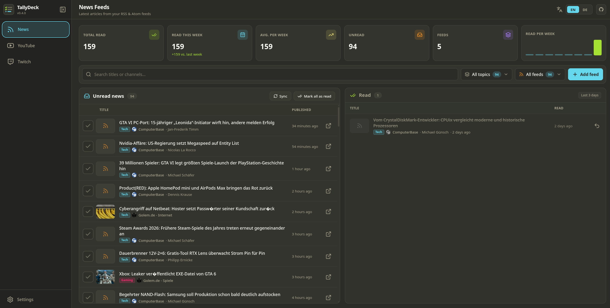

<h1 align="center">
   Tallydeck
</h1>

<p align="center">
  <strong>Your feeds, tallied.</strong> A self-hosted inbox-zero dashboard for <strong>RSS/Atom news feeds</strong>, <strong>YouTube channels</strong>, and <strong>Twitch streams</strong>,<br />
  built with a warm Monokai dark theme and full <strong>Docker / Docker Compose</strong> support on port <code>5555</code>.
</p>

<p align="center">
  
</p>

---

## Features

- **Two-Table Inbox-Zero Workflow:** Unread videos and news on the left, recently watched/read items on the right with one-click **Undo**, while keeping lifetime stats and duplicate protection in SQLite.
- **YouTube Without API Key & RSS Auto-Discovery:** Paste any YouTube channel link (`@handle`, `/channel/UC…`, or video URL) or website/feed URL – TallyDeck resolves the feed automatically and includes a **Hide Shorts** toggle.
- **Twitch Live Streams Tab (Zero Setup):** Track your favorite Twitch streamers as responsive 16:9 tiles showing live thumbnails, viewer counts, current game/category, and stream uptime – no API key or Twitch account required. Includes search, an **Online only / All channels** toggle, and configurable polling (minimum 15 min).
- **Topics & Tag Grouping:** Organize YouTube channels and RSS feeds by color-coded topics (e.g. *Tech*, *Gaming*, *Homelab*, *News*) with instant topic filters.
- **Statistics & Weekly Trend:** Tracks total watched/read, weekly progress vs. last week, weekly average, unread count, and an 8-week bar chart.
- **Customizable Settings Menu:**
  - **Themes & Layout:** Dark/Light mode, 5 color themes (*Monokai*, *Dracula*, *Nord*, *Catppuccin*, *Gruvbox*), and *Comfortable* or *Compact* table view.
  - **Sync & Inbox Control:** Configurable background sync intervals (feeds & Twitch), inbox display limits, history retention days, and optional auto-cleanup for old unread items.
  - **Backups, OPML & Twitch Import/Export:** Full database JSON backup & restore, separate OPML 2.0 import/export for YouTube and RSS, plus JSON/text import & export for Twitch channels.
- **Multilingual UI:** English (default) and German included.

---

## Run with Docker

TallyDeck runs in a single container on port **`5555`** and stores its SQLite database in `/app/data/tallydeck.db`. Multi-architecture images (`linux/amd64` and `linux/arm64`) are published automatically to the GitHub Container Registry (`ghcr.io`).

### Option 1: `docker run` (Pre-built Image)

```bash
docker run -d \
  --name tallydeck \
  -p 5555:5555 \
  -v tallydeck-data:/app/data \
  -e PORT=5555 \
  --restart unless-stopped \
  ghcr.io/einfachfabi/tallydeck:latest
```

Then open **<http://localhost:5555>** in your browser.

### Option 2: `docker compose` (Pre-built Image)

Save this as `docker-compose.yml` and run `docker compose up -d`:

```yaml
services:
  tallydeck:
    image: ghcr.io/einfachfabi/tallydeck:latest
    container_name: tallydeck
    ports:
      - "5555:5555"
    volumes:
      - tallydeck-data:/app/data
    environment:
      - PORT=5555
      - DB_PATH=/app/data/tallydeck.db
    restart: unless-stopped

volumes:
  tallydeck-data:
```

### Option 3: Build Locally with Docker Compose

If you cloned this repository and want to build the image locally:

```bash
git clone https://github.com/EinfachFabi/tallydeck.git
cd tallydeck
docker compose up -d --build
```

Then open **<http://localhost:5555>**.

---

## Configuration (Environment Variables)

| Variable                       | Default                  | Description                                               |
| ------------------------------ | ------------------------ | --------------------------------------------------------- |
| `PORT`                         | `5555`                   | HTTP server port                                          |
| `DB_PATH`                      | `/app/data/tallydeck.db` | Path to the SQLite database file                          |
| `TWITCH_POLL_INTERVAL_MINUTES` | `15`                     | Default Twitch polling interval in minutes (minimum `15`) |

> **Tip:** Both background sync intervals (Feeds: *Off / 5 / 15 / 30 / 60 min*, Twitch: *15 / 30 / 60 / 120 min*) and full database backups can be configured directly in the **Settings** menu inside the web UI.

### Database Backup

```bash
docker cp tallydeck:/app/data/tallydeck.db ./tallydeck-backup.db
```

---

## Local Development (Without Docker)

Requires **Node.js ≥ 22.13** (uses Node's built-in `node:sqlite`).

```bash
npm install
npm run dev        # Fastify API on :5555, Vite dev server on :5173 (proxying /api)
npm test           # Run backend unit & integration tests (node:test)
npm run build      # Typecheck + production bundle into dist/
npm start          # Start the production server on http://localhost:5555
```

### Project Structure

```text
.github/workflows/ GitHub Actions workflow (tests + multi-arch GHCR Docker publish)
server/            Fastify API, SQLite repository, RSS/Atom parser, YouTube resolver, Twitch service, schedulers
  tests/           node:test unit + API tests with fixtures
src/               React + Vite + Tailwind CSS frontend (Monokai theme)
  components/      Sidebar, TopBar, StatsBar, FilterBar, SplitFeedTables, SettingsModal
  pages/           DashboardPage (News & YouTube), TwitchPage
  i18n/            en.json, de.json, I18nContext
  utils/           Formatting helpers, localStorage hook, Monokai topic color palette
  navigation.ts    Sidebar navigation entries – extend here to add new pages
```

### REST API

| Method   | Endpoint                                          | Description                                                |
| -------- | ------------------------------------------------- | ---------------------------------------------------------- |
| `GET`    | `/api/health`                                     | Health status, sync interval, and last sync timestamps     |
| `GET`    | `/api/settings`                                   | Get server settings (sync intervals, auto-archive config)  |
| `PATCH`  | `/api/settings`                                   | Update server settings (`pollIntervalMinutes`, `twitchPollIntervalMinutes`, auto-archive) |
| `GET`    | `/api/backup`                                     | Export full JSON backup (feeds, items, Twitch channels, stats, settings) |
| `POST`   | `/api/backup`                                     | Restore full JSON backup                                   |
| `GET`    | `/api/feeds?type=youtube\|rss`                    | List subscribed channels or feeds with unread counts       |
| `POST`   | `/api/feeds`                                      | `{ type, url, category? }` – add channel/feed              |
| `PATCH`  | `/api/feeds/:id`                                  | `{ category }` – assign or change a feed's topic           |
| `DELETE` | `/api/feeds/:id`                                  | Remove a channel/feed and all its items                    |
| `POST`   | `/api/feeds/sync`                                 | `{ type?, feedId? }` – trigger immediate feed refresh      |
| `GET`    | `/api/feeds/opml?type=youtube\|rss`               | Export subscribed channels or feeds as an OPML 2.0 file    |
| `POST`   | `/api/feeds/opml`                                 | `{ type, opml }` – import channels or feeds from OPML XML  |
| `GET`    | `/api/items?type=&feedId=&category=&hideShorts=&inboxLimit=&completedDays=` | Uncompleted items, completed items, & stats |
| `PATCH`  | `/api/items/:id`                                  | `{ completed: boolean }` – mark item watched/read or undo  |
| `POST`   | `/api/items/complete-all`                         | `{ type, feedId?, category?, hideShorts? }` – complete all |
| `GET`    | `/api/twitch/streams`                             | Cached Twitch channels with live status, viewers, & game   |
| `POST`   | `/api/twitch/channels`                            | `{ channel }` – add Twitch channel by name or URL          |
| `DELETE` | `/api/twitch/channels/:id`                        | Remove a Twitch channel                                    |
| `POST`   | `/api/twitch/sync`                                | Trigger immediate Twitch live status refresh               |
| `GET`    | `/api/twitch/channels/export`                     | Export saved Twitch channels as JSON                       |
| `POST`   | `/api/twitch/channels/import`                     | `{ content }` – import Twitch channels from JSON or text   |
